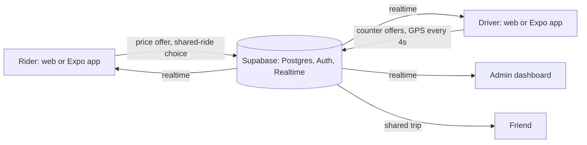

# 🚕 Negotiate Taxi
 
> **Name your price. Ride Stockholm.**
> An inDrive-style ride-hailing prototype for Sweden: riders offer a fare, licensed drivers counter, and a **binding fixed price** is locked before the trip. Live tracking for rider, driver, admin and a verified friend.

## Live demo
 
| Page | Link |
|---|---|
| Landing (cinematic scroll) | https://negotiate-taxi.vercel.app/ |

 
> Demo data only. Please do not enter real personal data. Admin credentials are not public.
> Tip: add a short screen recording to `docs/demo.gif` and show it here: ``
 


 

## Features
 
**Riders**
- Offer your own price, inside a **Swedish-market price range** (the minimum bid is enforced by the database)
- Real-time driver offers and counter-offers, then a **locked fixed price**
- **Shared ride option:** allow your driver to take one more passenger on the same route, or say no
- Live driver tracking, ETA, route line, SOS button
- Verified friends: share a trip so a friend can follow it live (only while the trip is active)
**Drivers**
- Approval by an admin before taking rides
- Go online, see a live request radar, accept or counter inside the allowed price range
- GPS broadcast every 4 seconds, route to pickup and destination
- Alerts for passengers on the **same route**, only if the current rider allowed sharing
**Admin**
- Live map of every driver (available or on a trip), waiting riders, trips and SOS alerts
- Driver approval and a **pricing editor** (start fee, per km, per hour, minimum and maximum bid)
## How it works
 

 
Security lives in the database (Row Level Security, triggers and functions), not only in the UI. For example, a bid below the minimum price is rejected by Postgres even if someone bypasses the app.
 
## Tech stack
 
Next.js (App Router), React, Leaflet and OpenStreetMap-based tiles, Expo (React Native), Supabase (Postgres, Auth, Realtime), Vercel.
 
## Repo layout
 
```
NegotiateTaxi/
├─ apps/
│  ├─ web/        Next.js: landing, /rider, /driver, /admin
│  │  └─ src/{app,components,lib}
│  └─ mobile/     Expo (React Native) app
└─ supabase/      schema.sql, phase2.sql, phase3.sql, phase5.sql
```
 
## Build it yourself (about 45 minutes)
 
### 0. You need
Free accounts at **GitHub**, **Supabase**, **Vercel** and **Expo** (expo.dev). Optional: the **Expo Go** app on your phone.
 
### 1. Get the code
Fork this repo, then **Code → Codespaces → Create codespace on main**. Everything runs in your browser.
 
### 2. Create the database
1. In Supabase: **New project** (pick a region near you).
2. **Authentication → Sign In / Providers → Email**: turn **Confirm email** off (development only).
3. **SQL Editor → New query**: paste and run these files **in this order**:
   `supabase/schema.sql` → `supabase/phase2.sql` → `supabase/phase3.sql` → `supabase/phase5.sql`
### 3. Environment variables
Use the **publishable / anon** key. **Never** use the secret key in these files.
 
`apps/web/.env.local`
```
NEXT_PUBLIC_SUPABASE_URL=https://YOUR-PROJECT.supabase.co
NEXT_PUBLIC_SUPABASE_ANON_KEY=YOUR-PUBLISHABLE-OR-ANON-KEY
```
 
`apps/mobile/.env`
```
EXPO_PUBLIC_SUPABASE_URL=https://YOUR-PROJECT.supabase.co
EXPO_PUBLIC_SUPABASE_ANON_KEY=YOUR-PUBLISHABLE-OR-ANON-KEY
```
 
### 4. Run the web app
```bash
cd apps/web
npm install
npm run dev
```
Open port 3000 from the **Ports** tab.
 
### 5. Create your admin
Supabase → **Authentication → Users → Add user** (tick *Auto Confirm User*). Then in the SQL Editor:
```sql
update profiles set role = 'admin', approved = true
where id = (select id from auth.users where email = 'YOUR-ADMIN-EMAIL');
```
 
### 6. (Optional) Run the mobile app
```bash
cd apps/mobile
npm install
npx expo install --check
npx expo login            # or: export EXPO_TOKEN=your-token
npx expo start --tunnel --clear
```
Scan the QR code with Expo Go.
 
### 7. Deploy to Vercel
1. vercel.com → **Add New → Project** → import your fork.
2. **Root Directory:** `apps/web`
3. Add the two `NEXT_PUBLIC_...` environment variables.
4. **Deploy.** Then in Supabase → **Authentication → URL Configuration** set the **Site URL** to your Vercel address.
### 8. Try it
1. Open `/admin` and log in.
2. Open `/driver` (second browser or phone), sign up, approve the driver in the admin page, tap **Go online**.
3. Open `/rider` on your phone, allow location, type a destination, tap **Price**, pick an offer inside the range, tap **Request ride**. Choose whether to allow a shared ride.
4. The driver counters, the rider accepts, and the live map updates for everyone.
5. To fake driver movement on a laptop: Chrome DevTools → ⋮ → More tools → **Sensors → Location**.
## Pricing (Swedish market)
 
Sweden has free taxi pricing, so there is no official tariff. The defaults follow a published Stockholm taxi tariff as a market reference:
 
```
guide price = start fee 59 kr + 14.90 kr per km + time (565 kr/hour, 595 kr/hour Fri 15:00 to Mon 06:00)
minimum bid = 85% of the guide price     (riders cannot go below it)
maximum bid = 150% of the guide price
```
 
Example: 10 km in 15 minutes on a weekday: guide about 349 kr, allowed range about 297 to 524 kr.
Admins can change every number in **Admin → Pricing**. Changes apply to new requests.
 
## Shared rides
 
1. When requesting, the rider sees a pop-up: *allow one more passenger on the same route?*
2. If **no**: the driver cannot add anyone. The database enforces this.
3. If **yes**: the driver is alerted to other requests that also allowed sharing, start near the same place (default 1.5 km) and end near the same place.
4. The second passenger accepts the driver's offer. Each passenger keeps their own price. Maximum one extra passenger. Both riders see who they share with (first name only).
## Troubleshooting
 
| Problem | Fix |
|---|---|
| `Couldn't create a signed tunnel URL` | Log in to Expo: `npx expo login`, or `export EXPO_TOKEN=...` |
| `AsyncStorageError: Native module is null` | `npx expo install @react-native-async-storage/async-storage`, then restart with `--clear` |
| GitHub blocks push: "Push cannot contain secrets" | A secret key is in a file. Use the publishable key, add `.env` to `.gitignore`, rewrite the commit, rotate the secret |
| `Invalid login credentials` | The user does not exist or the password is wrong. Create the user in Supabase → Authentication → Users |
| Map tiles show "Access blocked" or "API key required" | Use the Esri tile URL in `LiveMap.tsx` |
| Hydration warning in the console | Caused by browser extensions (Grammarly, autofill). Try an incognito window |
| `Your offer must be between X and Y kr` | The bid is outside the allowed price range. Pick a price inside it |
| Location not working | Allow location in the browser. It needs HTTPS (Vercel is HTTPS) |
 
## Security notes
 
- Keep `.env` and `.env.local` out of Git. Only the publishable key belongs in the apps.
- Row Level Security is on for every table. Review `supabase/*.sql` before launching.
- Turn **Confirm email** back on for any real deployment.
## Launching in Sweden
 
This is a **learning prototype**. A real launch needs licensed taxi operators and drivers, a taximeter or the booking-central route, tax reporting, GDPR work and legal advice. Read [`docs/SWEDEN_LAUNCH.md`](docs/SWEDEN_LAUNCH.md).
 
## Roadmap
 
Payments (Stripe Connect or Swish), BankID login, Swedish UI language, ratings, push notifications, native background GPS, price-proof receipts, taximeter integration.
 
